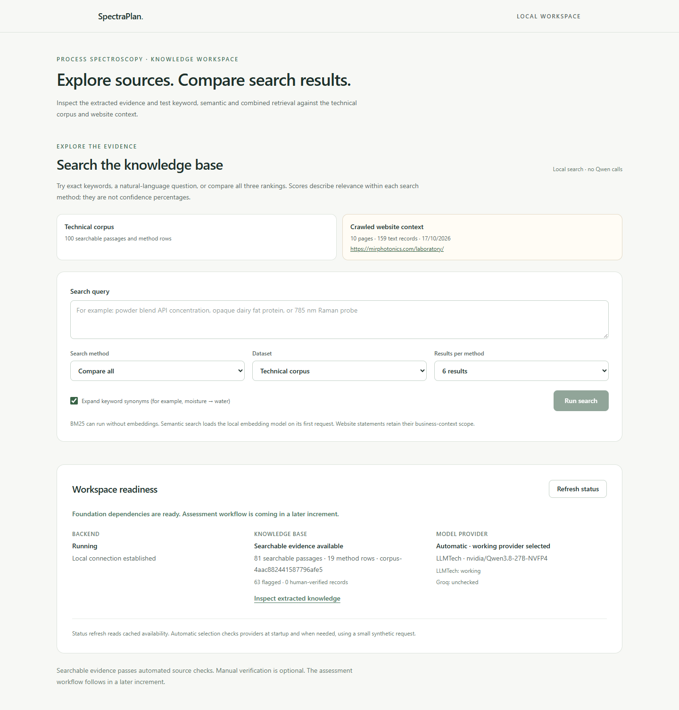
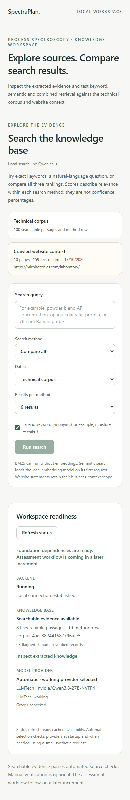

# Automatic provider readiness QA

- Summary: provider status reflects cached automatic selection; QA passed.
- Environment: http://127.0.0.1:5173/; 1440×1000 desktop and 390×844 mobile; Browser plugin not available, so bundled Playwright used installed Microsoft Edge. The bundled Chromium executable was absent; no dependencies were installed.
- Verified surface: Workspace readiness → Model provider → Automatic, LLMTech working, Groq unchecked in this application process.

| Check | Result |
|---|---|
| URL/title | Pass: SpectraPlan at the requested local URL |
| Meaningful content | Pass: search workspace and readiness panel |
| Framework overlay | None |
| Console health | No warnings/errors |
| Interaction | Refresh status preserves cached working-provider selection |
| Mobile overflow | None |
| Screenshot inspection | Desktop and mobile readable; no clipped provider status |

The interaction under test was app load → automatic working provider visible → Refresh status → same cached selection. Status refresh itself makes no provider call. Search and assessment UI redesign were outside this change.

The Browser plugin can streamline future in-app UI checks.

